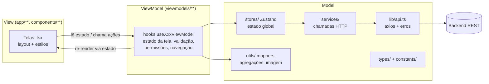

# Arquitetura do app mobile (MVVM)

O app RESOLVE mobile (Expo + React Native + expo-router) segue **MVVM — Model, View, ViewModel**.
A escolha casa com o que o React já oferece: a ViewModel é um *hook* que guarda o estado da tela
e expõe ações; a View é o componente que só desenha esse estado; o Model são os dados, as regras
de domínio e o acesso à API.

## Camadas



Versão ASCII:

```
  ┌──────────── View ────────────┐    ┌──────── ViewModel ────────┐    ┌───────────── Model ─────────────┐
  │ app/login.tsx                │    │ useLoginViewModel         │    │ stores/useAuthStore (Zustand)   │
  │ app/cadastro.tsx             │ ─▶ │ useCadastroViewModel      │ ─▶ │ stores/useDemandStore           │
  │ app/denuncias/nova.tsx       │ ◀─ │ useNovaDenunciaViewModel  │    │ services/* ─▶ lib/api.ts ─▶ API │
  │ app/gestor/index.tsx         │    │ useGestorDashboardVM      │    │ utils/* (mappers, métricas,     │
  │ components/ui/*              │    │                           │    │   filtros, imagem)  types/*     │
  └──────────────────────────────┘    └───────────────────────────┘    └─────────────────────────────────┘
       só layout, estilos e              estado da tela, validação,         dados, regras de domínio,
       chamadas da ViewModel             permissões, câmera/GPS,            persistência e rede
                                         navegação, mensagens de erro
```

### Model
- `types/` — tipos do domínio (`Demand`, `DemandFilters`, `MetricsKpis`...).
- `constants/` — listas fixas do domínio (categorias, regiões, problemas por categoria) e cores.
- `lib/api.ts` — cliente axios, base URL e `ApiError`.
- `services/` — uma função por endpoint (`authService`, `demandService`, `metricsService`).
- `utils/` — conversões puras: `demandMapper`/`metricsMapper` (API ↔ app), `metricsAggregator`
  (fatias e séries dos gráficos), `demandFilters`, `imageUtils` (compressão e base64),
  `permissionAlert`, `timeout`.
- `stores/` — estado global com Zustand (`useAuthStore` com sessão persistida no SecureStore,
  `useDemandStore` com lista, métricas e filtros). Ficam no Model porque são compartilhadas entre
  telas e não conhecem nenhuma tela.

### ViewModel
Um hook por tela, em `viewmodels/`. Cada um:
- guarda o estado local da tela (`useState`) e lê o estado global das stores;
- valida entradas e define as mensagens de erro;
- fala com recursos do aparelho (câmera, galeria, GPS) e trata permissões;
- chama as ações das stores/services e decide a navegação (`expo-router`);
- devolve um objeto com **dados prontos para exibir** e **funções de ação** — sem JSX.

### View
As telas em `app/` e os componentes em `components/` apenas montam o layout com o que a
ViewModel devolve e ligam os eventos (`onPress`, `onChangeText`) às ações dela. Não importam
stores, services nem `lib/api`. Exceção deliberada: a `ref` do `CameraView` fica na View, por ser
um handle do componente nativo; a View a entrega para `vm.takePicture(camera)` no clique.

## ViewModels

| ViewModel | Tela (View) | Responsabilidades |
|---|---|---|
| `useLoginViewModel` | `app/login.tsx` | campos e "Mantenha-me conectado", e-mail normalizado, validação, login, rota pós-login por papel |
| `useCadastroViewModel` | `app/cadastro.tsx` | campos, papel cidadão/gestor e código de acesso, validação (e-mail, senhas iguais), cadastro |
| `useNovaDenunciaViewModel` | `app/denuncias/nova.tsx` | 4 passos (foto → categoria → localização → descrição), validação por passo, câmera/galeria, GPS com tempo limite de 10 s e endereço reverso, alertas de permissão com "Abrir Ajustes", compressão da foto, envio e voltar (Android/gesto iOS) recuando uma etapa |
| `useGestorDashboardViewModel` | `app/gestor/index.tsx` | recarregar demandas + métricas a cada foco da tela, pull-to-refresh, filtros, dados dos gráficos (categoria, status, região, período) e total |
| `useAuth` (`hooks/`) | várias | atalho de leitura da sessão (nome, papel, logout) usado pelas ViewModels e pelo `AuthGuard` |

**Pendente:** `app/denuncias/index.tsx`, `app/denuncias/[id].tsx` e `app/gestor/[id].tsx` ainda leem
as stores direto na tela; o próximo passo é extrair `useMinhasDenunciasViewModel`,
`useDenunciaDetalheViewModel` e `useGestorDemandaViewModel` no mesmo padrão.

## Fluxo de exemplo: registrar uma denúncia

1. A View `nova.tsx` mostra o passo atual (`vm.step`) e chama `vm.nextStep()` em "Continuar".
2. `useNovaDenunciaViewModel` valida o passo; se falhar, preenche `vm.erro` e a View exibe a mensagem.
3. Em "Salvar", a ViewModel comprime a foto (`utils/imageUtils.compressImage`: lado maior até
   1280 px, JPEG 0.6) e chama `useDemandStore.createDemand`.
4. A store chama `demandService.create`, que converte a foto para base64 e faz o `POST` via `lib/api`.
5. Com sucesso a ViewModel mostra o alerta e navega para `/denuncias`; com erro, `vm.erro` recebe a
   mensagem da `ApiError`.

## Regras para código novo
- Tela nova → crie `viewmodels/useNomeDaTelaViewModel.ts` e deixe a tela só com JSX e estilos.
- Regra de negócio pura e reaproveitável (cálculo, formatação, conversão) → `utils/`, sem React.
- Estado que mais de uma tela precisa → store em `stores/`.
- Chamada HTTP nova → função em `services/`, nunca direto na View ou na ViewModel.
