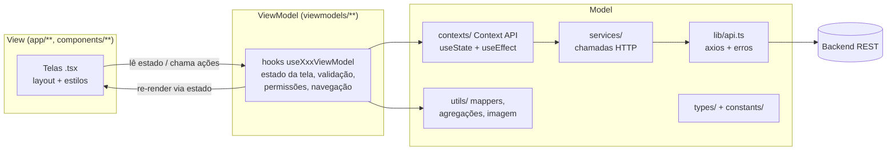

# Arquitetura do app mobile (MVVM)

O app RESOLVE mobile (Expo + React Native + expo-router) segue **MVVM — Model, View, ViewModel**.
A escolha casa com o que o React já oferece: a ViewModel é um *hook* que guarda o estado da tela
e expõe ações; a View é o componente que só desenha esse estado; o Model são os dados, as regras
de domínio e o acesso à API.

## Camadas



Versão ASCII:

```
  ┌──────────── View ────────────┐    ┌──────── ViewModel ────────┐    ┌───────────── Model ─────────────┐
  │ app/login.tsx                │    │ useLoginViewModel         │    │ contexts/AuthContext            │
  │ app/cadastro.tsx             │ ─▶ │ useCadastroViewModel      │ ─▶ │ contexts/DemandContext          │
  │ app/denuncias/nova.tsx       │ ◀─ │ useNovaDenunciaViewModel  │    │ services/* ─▶ lib/api.ts ─▶ API │
  │ app/gestor/index.tsx         │    │ useGestorDashboardVM      │    │ utils/* (mappers, métricas,     │
  │ app/denuncias/index.tsx      │    │ useMinhasDenunciasVM      │    │   filtros, imagem)  types/*     │
  │ app/denuncias/[id].tsx       │    │ useDenunciaDetalheVM      │    │                                 │
  │ app/denuncias/editar/[id]    │    │ useEditarDenunciaVM       │    │                                 │
  │ app/gestor/[id].tsx          │    │ useGestorDemandaVM        │    │                                 │
  │ components/ui/*              │    │ useExcluirDenuncia        │    │                                 │
  └──────────────────────────────┘    └───────────────────────────┘    └─────────────────────────────────┘
       só layout, estilos e              estado da tela, validação,         dados, regras de domínio,
       chamadas da ViewModel             permissões, câmera/GPS,            persistência e rede
                                         navegação, mensagens de erro
```

### Model
- `types/` — tipos do domínio (`Demand`, `DemandFilters`, `MetricsKpis`...).
- `constants/` — listas fixas do domínio (categorias, regiões, problemas por categoria) e cores.
- `lib/api.ts` — cliente axios, base URL e `ApiError`.
- `services/` — uma função por endpoint (`authService`, `demandService`, `metricsService`).
- `utils/` — conversões puras: `demandMapper`/`metricsMapper` (API ↔ app), `metricsAggregator`
  (fatias e séries dos gráficos), `demandFilters`, `imageUtils` (compressão e base64),
  `permissionAlert`, `timeout`.
- `contexts/` — estado global com a Context API do React, usando só `useState` e `useEffect`:
  - `AuthContext`: sessão (token, papel, nome, e-mail). Um `useEffect` restaura a sessão salva no
    `expo-secure-store` ao abrir o app e outro grava ou apaga a sessão a cada login/logout
    (respeitando o "Mantenha-me conectado").
  - `DemandContext`: lista, métricas, filtros e as ações (criar, editar, excluir, mudar status e
    prioridade). Os dados são limpos quando a sessão muda.
  Ficam no Model porque são compartilhados entre telas e não conhecem nenhuma tela.
- `lib/secureStorage.ts` — leitura e gravação da sessão no SecureStore.
- `lib/authToken.ts` — cópia da sessão atual para o axios, que roda fora dos componentes.

### ViewModel
Um hook por tela, em `viewmodels/`. Cada um:
- guarda o estado local da tela (`useState`) e lê o estado global dos contexts;
- valida entradas e define as mensagens de erro;
- fala com recursos do aparelho (câmera, galeria, GPS) e trata permissões;
- chama as ações dos contexts e decide a navegação (`expo-router`);
- devolve um objeto com **dados prontos para exibir** e **funções de ação** — sem JSX.

### View
As telas em `app/` e os componentes em `components/` apenas montam o layout com o que a
ViewModel devolve e ligam os eventos (`onPress`, `onChangeText`) às ações dela. Não importam
contexts, services nem `lib/api`. Exceção deliberada: a `ref` do `CameraView` fica na View, por ser
um handle do componente nativo; a View a entrega para `vm.takePicture(camera)` no clique.

## ViewModels

| ViewModel | Tela (View) | Responsabilidades |
|---|---|---|
| `useLoginViewModel` | `app/login.tsx` | campos e "Mantenha-me conectado", e-mail normalizado, validação, login, rota pós-login por papel |
| `useCadastroViewModel` | `app/cadastro.tsx` | campos, papel cidadão/gestor e código de acesso, validação (e-mail, senhas iguais), cadastro |
| `useNovaDenunciaViewModel` | `app/denuncias/nova.tsx` | 4 passos (foto → categoria → localização → descrição), validação por passo, câmera/galeria, GPS com tempo limite de 10 s e endereço reverso, alertas de permissão com "Abrir Ajustes", compressão da foto, envio e voltar (Android/gesto iOS) recuando uma etapa |
| `useGestorDashboardViewModel` | `app/gestor/index.tsx` | recarregar demandas + métricas a cada foco da tela, pull-to-refresh, filtros, dados dos gráficos (categoria, status, região, período) e total |
| `useMinhasDenunciasViewModel` | `app/denuncias/index.tsx` | carregar as denúncias do cidadão, pull-to-refresh, filtros e busca, navegação para detalhe e nova denúncia |
| `useDenunciaDetalheViewModel` | `app/denuncias/[id].tsx` | buscar a denúncia, dizer se ainda pode ser alterada (só Aberta), editar e excluir |
| `useGestorDemandaViewModel` | `app/gestor/[id].tsx` | buscar a demanda, mudar status e prioridade com mensagem de erro, excluir |
| `useEditarDenunciaViewModel` | `app/denuncias/editar/[id].tsx` | campos editáveis, validação, envio só do que mudou |
| `useExcluirDenuncia` | detalhes do cidadão e do gestor | confirmação, exclusão e volta para a lista |
| `useAuth` (`hooks/`) | várias | atalho de leitura da sessão (nome, papel, logout) usado pelas ViewModels e pelo `AuthGuard` |

Todas as telas de `app/` usam uma ViewModel; nenhuma lê os contexts direto.

## Fluxo de exemplo: registrar uma denúncia

1. A View `nova.tsx` mostra o passo atual (`vm.step`) e chama `vm.nextStep()` em "Continuar".
2. `useNovaDenunciaViewModel` valida o passo; se falhar, preenche `vm.erro` e a View exibe a mensagem.
3. Em "Salvar", a ViewModel comprime a foto (`utils/imageUtils.compressImage`: lado maior até
   1280 px, JPEG 0.6) e chama `createDemand` do `DemandContext`.
4. O context chama `demandService.create`, que converte a foto para base64 e faz o `POST` via
   `lib/api`; o progresso do envio aparece na tela ("Enviando... 45%").
5. Com sucesso a ViewModel mostra o alerta e navega para `/denuncias`; com erro, `vm.erro` recebe a
   mensagem da `ApiError`.

## Regras para código novo
- Tela nova → crie `viewmodels/useNomeDaTelaViewModel.ts` e deixe a tela só com JSX e estilos.
- Regra de negócio pura e reaproveitável (cálculo, formatação, conversão) → `utils/`, sem React.
- Estado que mais de uma tela precisa → `contexts/`, com `useState` e `useEffect`.
- Chamada HTTP nova → função em `services/`, nunca direto na View ou na ViewModel.
